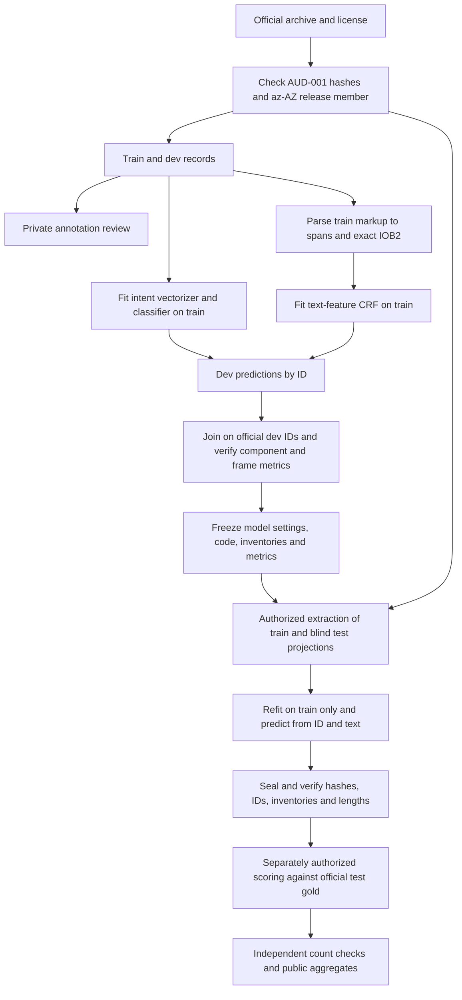

# AzMASSIVE benchmark architecture

The unit of evaluation is an official MASSIVE record ID. Intent and slot models fit independently. A frame is correct when the predicted intent and the complete set of typed character spans are both correct for that ID. This architecture measures end-to-end frame accuracy without a shared neural encoder. [Joint evaluator](../src/azmassive/joint_eval.py)

## Components and boundaries

| Responsibility | Implementation and review observations |
|---|---|
| Acquisition and integrity | The [release loader](../src/azmassive/dataset.py) takes an already acquired archive, verifies it against AUD-001 and extracts only named regular files after member checks. The early intent loader validates all splits structurally and returns only train/dev for learning. Later [SVC loading](../src/azmassive/intent_svc.py) skips test rows before validation. The source audit's historical structural exposure is documented. |
| Lexical intent models | [PR5](../src/azmassive/experiment.py) fits character 3–5 TF-IDF and logistic regression. [LinearSVC](../src/azmassive/intent_svc.py) reuses the vectorizer. The [hybrid](../src/azmassive/intent_hybrid.py) adds word unigrams/bigrams and a final row normalization. Vocabulary and IDF come from train. Case and original Azerbaijani text are preserved. Majority supplies a reference. |
| Gold spans and prediction inputs | The [slot parser](../src/azmassive/slots.py) reconstructs the source markup left-to-right, checks exact equality and encodes spans using text-only Unicode word/punctuation token offsets. The [prep audit](../src/azmassive/slot_prep.py) compares tokenizers and reports failures. Prediction receives tokens from original text alone. |
| Sequence model | [Local features](../src/azmassive/slot_features.py) include surface, casefolded form, affixes, shape, digit and punctuation indicators, neighbors and boundaries. [CRFsuite training](../src/azmassive/slot_crf.py) retains source order. The controlled 100/300 budget comparison changes only the iteration limit. Neither intent nor gold markup enters CRF inference. |
| Evaluation | [Slot metrics](../src/azmassive/slot_metrics.py) log orphan/wrong-type I-to-B repairs. Invalid tags/lengths are rejected. The joint runner aligns saved development predictions to gold and checks component metrics. [Final metrics](../src/azmassive/final_metrics.py) pool exact typed-span counts, use 60 fixed intent labels and compute utterance-paired bootstrap intervals. [Independent counts](../src/azmassive/eval_freeze_stats.py) check point estimates. |
| Final protocol | [CLI](../src/azmassive/eval_freeze.py), [protocol](../src/azmassive/final_protocol.py) and [model fitting](../src/azmassive/final_models.py) separate static preparation, authorized extraction, blind inference, gold-free verification and authorized scoring. Blind projection contains only ID/text. The scorer rechecks sealed artifacts and validates original gold. The private directory retains projections, ID-level predictions, diagnostics and manifests. |
| Review and publication | [Review preparation](../src/azmassive/annotation_review.py) reads train/dev with an early partition filter and writes ignored sheets. Public experiment configurations, summaries and verification evidence live under `configs/`, `docs/experiments/` and `results/`. The [held-out table](../results/EVAL-FREEZE-001/held-out-breakdowns.md) is the reporting source. |

## Lifecycle and maintainability

Historical runs follow config → smoke → full train/dev run → ID-based verification → dated experiment record. JOINT-EVAL reused saved predictions without refitting. EVAL-FREEZE pinned the implementations and fit partition before test prediction. New research should consume the verified results and private review workflow. A post-freeze encoder comparison needs a distinct protocol and train/dev or genuinely untouched evaluation data.

Three implementation details matter for future work. First, the legacy Conda file specifies Python 3.11 with an absolute prefix, while actual runs use CPython 3.12.4 and two requirements files. Some older manifests also contain machine-specific paths. Second, partition selection and CRFsuite training/termination extraction appear in several runners. The final runner reads iteration numbers from formatted trainer logs. Effective-parameter and hash checks constrain the frozen version, but future implementations could drift. Third, stage and score write several files in sequence. The code rejects existing outputs; interruption between writes can leave an incomplete directory. Synthetic tests cover malformed predictions, stale validation, hash mismatches and authorization. Crash recovery is a separate lifecycle concern. These are risks for independent reproduction or extensions. The published hashes and point checks still stand. [Gap register](thesis-gap-register.md)

For a read-only protocol check run `PYTHONPATH=src python3 -B -m azmassive.eval_freeze prepare` from the repository root. It validates static pins without opening the official corpus. For the complete synthetic/dev unit suite include the dependencies in both requirements files. No held-out replay is needed for routine architecture review.
